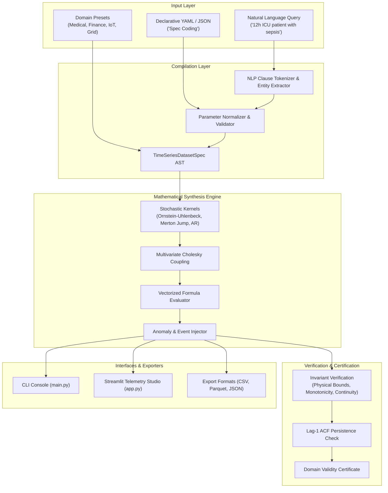

# SynSeries

**Physics-Informed and Domain-Constrained Synthetic Time-Series Framework**

[](#)
[](#)
[](#)
[](#)

---

## Overview

Machine learning models trained on synthetic time-series frequently fail in production due to **invariant violation** and **temporal drift**. Unconditional generative models (such as vanilla GANs or diffusion networks) optimize for statistical moment matching but lack intrinsic knowledge of physical conservation laws, anatomical boundaries, or market arbitrage constraints.

**SynSeries** is an end-to-end framework designed to synthesize high-fidelity, multivariate time-series datasets that strictly adhere to domain-specific invariants. The framework unifies:

1. **Constrained Stochastic Differential Equations (SDEs)** and dynamical physical kernels.
2. **Multivariate Cross-Channel Coupling** via Cholesky decomposition and rank-correlation projections.
3. **Declarative Specification ("Spec Coding")** with an offline Natural Language Compiler that translates plain English queries into validated schema definitions.
4. **Automated Invariant Auditing** that computes physical compliance certificates, autocorrelation (ACF) memory persistence, and boundary verification before dataset export.

---

## Core Domain Implementations

SynSeries provides dedicated generative kernels across six mission-critical domains:

### 1. Clinical and Physiological Systems
- **Dynamical Cardiac Cycle (Lead II ECG)**: Formulated via angular phase trajectory $\theta(t)$ and sum-of-Gaussians modeling atrial and ventricular depolarization/repolarization ($P, Q, R, S, T$ complexes) with autonomic respiratory sinus arrhythmia (RSA) and arrhythmia injection (PVC, tachycardia, bradycardia).
- **ICU Multi-Parameter Hemodynamics**: Coupled vital signs (Heart Rate, Systolic/Diastolic Blood Pressure, Mean Arterial Pressure, $\text{SpO}_2$, Respiratory Rate, Core Body Temperature). Enforces the physiological invariant $\text{Systolic} > \text{Diastolic} + 15\text{ mmHg}$ and models progressive septic shock dynamics (systemic vasodilation with compensatory tachycardia).
- **Continuous Glucose Monitoring (CGM)**: Models meal digestion carbohydrate absorption using gamma curves coupled with basal insulin decay and circadian hepatic glucose release (dawn phenomenon).

### 2. Quantitative Finance and Market Microstructure
- **Merton Jump-Diffusion**: Asset price trajectories governed by geometric Brownian motion compounded with Poisson jump processes for realistic heavy-tailed market returns:
  $$\frac{dS_t}{S_t} = (\mu - \lambda k) dt + \sigma dW_t + (e^J - 1) dN_t$$
- **No-Arbitrage OHLCV Aggregation**: Intraday sub-step excursions aggregated into candlestick intervals strictly guaranteeing no-arbitrage boundary conditions:
  $$\text{High}_t \ge \max(\text{Open}_t, \text{Close}_t), \quad \text{Low}_t \le \min(\text{Open}_t, \text{Close}_t), \quad \text{Volume}_t > 0$$
- **Correlated Asset Portfolios**: Multi-asset equity/commodity/crypto baskets coupled via target empirical correlation matrices.

### 3. Industrial IoT and Predictive Maintenance
- **High-Frequency Accelerometer Vibration**: 3-axis g-force telemetry modeling baseline shaft rotational harmonics and characteristic bearing defect frequencies:
  - Ball Pass Frequency Outer Race (BPFO)
  - Ball Pass Frequency Inner Race (BPFI)
  - Dynamic transient ringing modulated by shaft rotational speed.
- **Run-to-Failure Degradation**: Multi-sensor thermal and vibration degradation trajectories tracking Remaining Useful Life (RUL) with exponential wear curves and accelerated failure regimes.

### 4. Smart Energy Grids and Renewables
- **Solar Photovoltaic Generation**: Astronomical solar zenith angle modeling with pink-noise cloud attenuation factors.
- **Wind Turbine Generation**: Weibull wind speed distribution mapped through non-linear aerodynamic power curves with cut-in, rated, and cut-out speeds.
- **Grid Frequency Dynamics**: 50 Hz / 60 Hz rotational swing equation modeling inertia response and sudden generator trip contingencies.

### 5. Cloud Infrastructure and Site Reliability Engineering (SRE)
- **APM Telemetry**: Request throughput, CPU saturation curves, and lognormal latency distributions ($p_{50}, p_{95}, p_{99}$).
- **Memory Leak and Crash Cycles**: Monotonic memory consumption leading to Out-Of-Memory (OOM) threshold container restarts.

### 6. Meteorology and Climate
- **Atmospheric Coupling**: Solar irradiance driving ambient temperature with thermal phase-lag, coupled to relative humidity via Clausius-Clapeyron saturation vapor pressure bounds.

---

## System Architecture



---

## Installation

### Prerequisites
- Python 3.10, 3.11, or 3.12
- Standard virtual environment tools

### Setup

```bash
# Clone the repository
git clone https://github.com/mohammadkashish003/synseries.git
cd synseries

# Create and activate virtual environment
python3 -m venv .venv
source .venv/bin/activate

# Install dependencies
pip install -r requirements.txt
# or install package in editable mode
pip install -e .
```

### Dependencies
- `numpy`, `pandas`, `scipy` (numerical computation and SDE integration)
- `pyyaml` (declarative specification serialization)
- `matplotlib`, `plotly` (waveform rendering and phase portraits)
- `rich` (CLI terminal formatting)
- `streamlit` (interactive web telemetry studio)

---

## Declarative Specification ("Spec Coding")

SynSeries allows any time-series dataset to be completely specified as reproducible code. Specifications define sampling rates, deterministic trends, multi-frequency seasonalities, colored noise spectra ($1/f$ pink, brown, white), and mathematical formula derivations.

### Example: Aerospace Turbine Telemetry (`spec.yaml`)

```yaml
name: aerospace_turbofan_telemetry
domain: iot
start_time: "2026-03-01 00:00:00"
frequency: "100ms"
n_steps: 2500
random_seed: 42

variables:
  - name: spool_speed_rpm
    base: 12500.0
    trend:
      kind: linear
      slope: 0.12
    seasonality:
      - period: 50.0
        amplitude: 150.0
        waveform: sine
    noise:
      kind: pink
      std: 12.0

  - name: exhaust_gas_temp_c
    formula: "420.0 + 0.018 * spool_speed_rpm + normal(0, 2.5)"

  - name: casing_vibration_g
    process_type: ou
    process_params:
      theta: 0.25
      mu: 1.85
      sigma: 0.40

anomalies:
  - type: spike
    target: spool_speed_rpm
    start: 1200
    magnitude: 850.0
  - type: drift
    target: exhaust_gas_temp_c
    start: 1800
    duration: 500
    magnitude: 45.0
```

Generate directly from this specification:
```bash
python main.py generate --spec examples/example_specs/aerospace_turbine_anomaly.yaml --output turbine.parquet
```

---

## Natural Language Query Compiler

Instead of manual configuration, plain English requests can be compiled into validated specifications:

```bash
# Compile and inspect generated YAML specification
python main.py spec "12 hours of ICU patient telemetry with septic shock" --format yaml
```

The compiler extracts:
- **Temporal Parameters**: Duration, step count, and sampling frequencies.
- **Domain Identification**: Maps domain semantics (medical, finance, IoT, energy, web).
- **Physical Dynamics**: Configures physiological coupling, jump diffusion parameters, or defect frequencies.
- **Anomalies**: Detects event triggers (spikes, drifts, regime shifts, or sensor dropouts).

---

## Command Line Interface (CLI)

The CLI provides entry points for automated workflows:

```bash
# Generate dataset from prompt with automatic validation
python main.py generate \
    --prompt "500 bars of AAPL stock market OHLCV with volume spikes" \
    --output aapl_candlesticks.csv \
    --validate

# Generate dataset from YAML specification and display summary plot
python main.py generate \
    --spec examples/example_specs/medical_icu_septic_shock.yaml \
    --output icu_vitals.csv \
    --plot

# Audit an existing dataset file for physical invariant compliance
python main.py validate icu_vitals.csv --domain medical

# Launch the interactive telemetry studio
python main.py ui
```

---

## Python API Usage

SynSeries can be integrated directly into machine learning pipelines:

```python
import synseries as ss

# 1. Generate directly from a natural language prompt
df_icu = ss.generate("12 hours of ICU patient telemetry with septic shock")
print(df_icu.head())

# 2. Perform automated physical invariant audit
audit = ss.validate(df_icu, domain="medical")
print(f"Compliance Score: {audit['score_pct']}% - Status: {audit['overall_status']}")
for check in audit["checks"]:
    print(f"[{check['status']}] {check['name']}: {check['details']}")

# 3. Generate quantitative finance OHLCV data
df_ohlcv = ss.generate("500 bars of AAPL OHLCV with high volume")
print(df_ohlcv[["open", "high", "low", "close", "volume", "vwap"]].head())

# 4. Generate from a YAML specification file and export to Parquet
df_turbine = ss.generate("examples/example_specs/aerospace_turbine_anomaly.yaml")
df_turbine.to_parquet("turbine_telemetry.parquet")
```

---

## Invariant Verification and Auditing

To guarantee that synthetic data is indistinguishable from real physical processes, SynSeries executes an automated multi-point verification suite:

| Check | Target Dimension | Pass Condition |
| :--- | :--- | :--- |
| **Chronological Monotonicity** | Timestamp Index | $\Delta t > 0, \quad \forall t$ |
| **Numerical Stability** | All Channels | $\text{NaN Count} = 0, \quad \text{Inf Count} = 0$ |
| **Physiological BP Bounds** | Systolic / Diastolic | $\text{Systolic}_t > \text{Diastolic}_t + 10\text{ mmHg}$ |
| **Oxygen Saturation** | $\text{SpO}_2$ | $50\% \le \text{SpO}_2 \le 100\%$ |
| **No-Arbitrage Candlesticks** | OHLCV | $\text{High}_t \ge \max(\text{Open}_t, \text{Close}_t), \quad \text{Low}_t \le \min(\text{Open}_t, \text{Close}_t)$ |
| **Positive Trading Volume** | Volume | $\text{Volume}_t > 0$ |
| **Temporal Persistence** | Autocorrelation | $\text{ACF}(1) \ge 0.50$ (smooth continuous dynamics) |
| **Covariance Stability** | Multivariate Channels | Target correlation error $\Vert \mathbf{R}_{\text{target}} - \mathbf{R}_{\text{empirical}} \Vert_F \le 0.15$ |

---

## Interactive Telemetry Studio

SynSeries includes a high-density, real-time telemetry console built with Streamlit and Plotly:

```bash
streamlit run synseries/app.py
```

### Features:
- **Three-Column Cyber-Physical Layout**: Left column for model configuration, center column for multi-channel waveforms and invariant progress monitors, right column for phase portraits and verification terminal logs.
- **Waveform Inspection**: Real vs. synthetic overlays, confidence envelopes, and automated transient/stationary state annotations.
- **Dynamical Phase Portrait**: 2D state-space trajectory ($\dot{x}$ vs. $x$) visualization for stability and attractor analysis.
- **Dataset Export**: One-click download in CSV, Parquet, and JSON formats.

---

## Verification and Unit Tests

The test suite covers signal primitives, SDE integration, correlation induction, specification compilation, and physical invariant validation:

```bash
python -m unittest tests/test_generation.py
```

```text
Ran 9 tests in 0.051s

OK
```

All 9 unit tests pass deterministically.

---

## Directory Structure

```text
synthetic_timeseries_generator/
├── README.md
├── pyproject.toml
├── main.py
├── synseries/
│   ├── __init__.py
│   ├── cli.py
│   ├── app.py
│   ├── core/
│   │   ├── spec.py
│   │   ├── engine.py
│   │   ├── signal_generators.py
│   │   ├── correlations.py
│   │   ├── anomalies.py
│   │   └── evaluator.py
│   ├── domains/
│   │   ├── medical.py
│   │   ├── finance.py
│   │   ├── iot_industry.py
│   │   ├── energy_grid.py
│   │   ├── web_traffic.py
│   │   └── climate.py
│   ├── nlp/
│   │   └── prompt_compiler.py
│   └── validation/
│       ├── authenticity.py
│       └── reporter.py
├── examples/
│   ├── quickstart.py
│   └── example_specs/
│       ├── medical_icu_septic_shock.yaml
│       └── aerospace_turbine_anomaly.yaml
└── tests/
    └── test_generation.py
```

---

## License

This project is licensed under the MIT License - see the LICENSE file for details.
